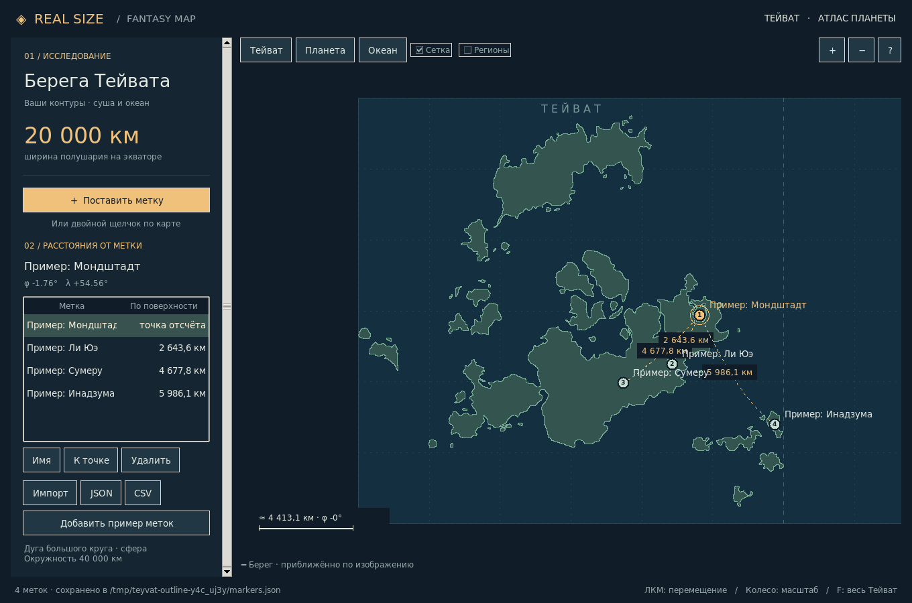

# Real Size Fantasy Map

Офлайн-прототип на **Python + Tkinter**: исследование берегов Тейвата в масштабе планеты. Перемещение мышью, масштабирование к курсору, пользовательские метки и расстояния от выбранной метки до всех остальных.



## Запуск

Нужен **Python 3.10+ с Tkinter**. Для самого приложения пакеты из pip не нужны.

```bash
git clone https://github.com/TopoLM21/RealSizeFantasyMap.git
cd RealSizeFantasyMap
python app.py
```

Windows: можно открыть `start.bat`; при установке Python должен быть включён компонент Tcl/Tk. Если команда `python` недоступна, используйте `py -3 app.py`.

Ubuntu/Debian: `sudo apt install python3-tk`, затем `python3 app.py`. На macOS подойдёт установщик Python с python.org с поддержкой Tk. Нужен обычный графический рабочий стол; приложение не является веб-сервером.

Для первого знакомства:

```bash
python app.py --demo
```

Демо добавляется только при отсутствии файла меток. Его точки приблизительные и не являются официальными координатами городов. В интерфейсе тоже есть кнопка добавления примера.

## Управление

| Действие | Управление |
| --- | --- |
| Перемещение | Зажать ЛКМ и тянуть карту |
| Приближение / отдаление | Колесо мыши или кнопки + / − |
| Новая метка | Двойной щелчок либо «Поставить метку», затем щелчок |
| Выбрать точку отсчёта | Щелчок по метке или строке списка |
| Увидеть расстояния | Выбрать метку; список и дуги обновятся для остальных |
| Вернуться к выбранной точке | «К точке» или двойной щелчок по строке |
| Изменить имя / удалить | Кнопки под списком или ПКМ по метке |
| Удалить выбранную метку | Delete |
| Показать Тейват целиком | F или «Тейват» |
| Показать всю планету / океан | «Планета» / «Океан» |
| Отменить установку | Esc |
| Сохранить | Автоматически после изменений; также Ctrl+S |

Метки могут находиться и на суше, и в океане. Сетка и приблизительные подписи регионов включаются отдельно. При выборе другой метки все расстояния пересчитываются. Метки удаляются сразу.

## Масштаб и измерения

«Полушарие 20 000 км» здесь означает **180° долготы / половину окружности по экватору**, а не диаметр планеты или размер изображения в пикселях:

- окружность сферы ровно **40 000 км**, радиус ≈ **6 366,2 км**;
- Тейват занимает полушарие от −90° до +90° долготы: ширина контура суши нормирована к **20 000 км** по экватору;
- противоположное полушарие (+90°…+270°) — океан;
- высота снимка масштабируется с тем же коэффициентом, ориентация сохраняется;
- используется равнопромежуточная цилиндрическая проекция всей планеты 40 000 × 20 000 км;
- расстояние — кратчайшая дуга большого круга по формуле гаверсинуса. Оно учитывает широту и переход через край проекции. Максимум — **20 000 км**;
- дуги на карте соответствуют этому измерению, а не прямым экранным отрезкам. Для точных антиподов выбирается одна из равноценных дуг;
- масштабная линейка показывает приближённое расстояние на указанной рядом широте. Проекция растягивает приполярные области;
- расстояния не учитывают рельеф, дороги и препятствия. Это условная планетарная модель, не игровой масштаб Genshin Impact.

Масштаб 1:1 здесь реализован координатами в реальных километрах. Физический масштаб на экране зависит от размера монитора и зума.

## Данные карты

Основная подложка обновлена по **уточнённому рисунку пользователя 1024×1024: чёрные контуры на белом фоне**. Замкнутые белые области выделяются отдельно: так тонкая общая граница не объединяет соседние острова. Расширение и замыкание линий отключены; ручных поправок нет. Замкнутые внутренние водоёмы заполняются, как в прежней подложке. Источники, обработка и воспроизводимость: [SOURCES.md](SOURCES.md).

Получено **57 компонентов суши, 4976 вершин**. Малые острова сохраняются от 4 пикселей площади. Берег проходит у внутреннего края нарисованного штриха; его толщина и упрощение с допуском 0,45 пикселя ограничивают точность векторизации. Один пиксель равен ≈ **26,08 км** условного планетарного масштаба. Это более верное воспроизведение вашего рисунка, но не геодезическая съёмка. Старые контуры 4.0 сохранены отдельно в `data/coastline-v4.json`; предыдущая цветная подложка доступна в истории Git.

Готовые файлы береговой линии:

- [SVG — чистые векторные линии](data/coastline.svg), прозрачный фон;
- [GeoJSON — полигоны](data/coastline.geojson), условные долгота/широта этой планеты;
- [JSON — координаты в километрах для приложения](data/coastline.json);
- [PNG — предпросмотр](data/coastline-preview.png);
- [Бинарная маска суши](data/coastline-mask.png).

GeoJSON использует вымышленную географию; это не реальные координаты Земли и не геодезическая модель WGS84. Демо-метки и подписи адаптированы под новую подложку. **Старые сохранённые метки сохраняют числовые координаты**, поэтому их положение относительно нового контура нужно проверить и при необходимости поставить заново.

## Сохранение и перенос

По умолчанию метки записываются в `~/.realsizefantasymap/markers.json`, отдельно от репозитория. Сохранение атомарное. Ошибка записи показывается внизу окна; при закрытии с несохранёнными изменениями приложение предлагает повторить сохранение. Повреждённый файл при запуске сам по себе не перезаписывается.

Свой путь к данным:

```bash
python app.py --markers ./my-expedition.json
```

Кнопка **JSON** экспортирует метки, **Импорт** загружает и после подтверждения заменяет текущий список, **CSV** выгружает расстояния от выбранной точки. Импорт проверяет координаты, названия и уникальность идентификаторов; предел прототипа — 1000 меток. CSV открывается в электронных таблицах (UTF-8 с BOM, разделитель `;`).

## Проверка и структура

```bash
python -m unittest discover -s tests -v
```

`app.py` — интерфейс и отрисовка; `geometry.py` — сфера, проекция, камера; `storage.py` — проверка/сохранение JSON; `data/coastline.json` — контуры в километрах. Для повторного извлечения из предоставленного изображения:

```bash
python -m pip install -r requirements-tools.txt
python tools/vectorize_user_map.py /path/to/original-image.jpg
```

Параметры записаны в `data/user-map-profile.json`. Размер и SHA-256 проверяются: профиль подходит именно к последнему рисунку. Вырезание контуров использует Pillow, NumPy и SciPy, но запуск готового приложения по-прежнему обходится без pip-зависимостей и без venv. Профиль предыдущей цветной карты оставлен как `data/user-map-color-profile.json`; для него применяется `--profile data/user-map-color-profile.json`. Старый `tools/extract_coastline.py` воспроизводит снимок 4.0 в архивном `data/coastline-v4.json`.

26 проверок: геометрия, сохранение, соответствие SVG/GeoJSON данным карты, открытая вода, малые острова, разделение соседних замкнутых областей и 5 интеграционных проверок Tk. Три проверки подготовки контуров пропускаются без необязательных пакетов из `requirements-tools.txt`. На Linux без `DISPLAY` проверки интерфейса автоматически пропускаются. Проверено с Python 3.13 / Tk 8.6 в виртуальном X-дисплее. В минимальных сборках Tk без поддержки системных Unicode-шрифтов кириллица может не отображаться: используйте стандартную сборку Python/Tk вашей ОС.

Фанатский экспериментальный проект, не связан с HoYoverse. Права на исходную географию и материалы Genshin Impact принадлежат их правообладателям.
